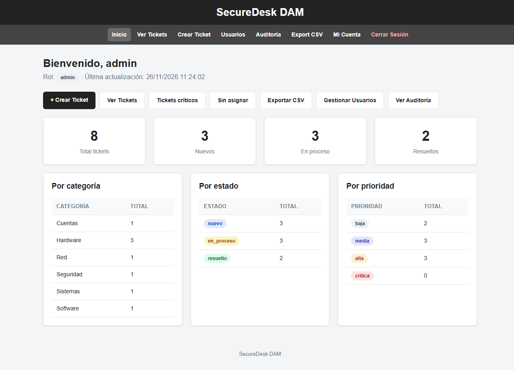
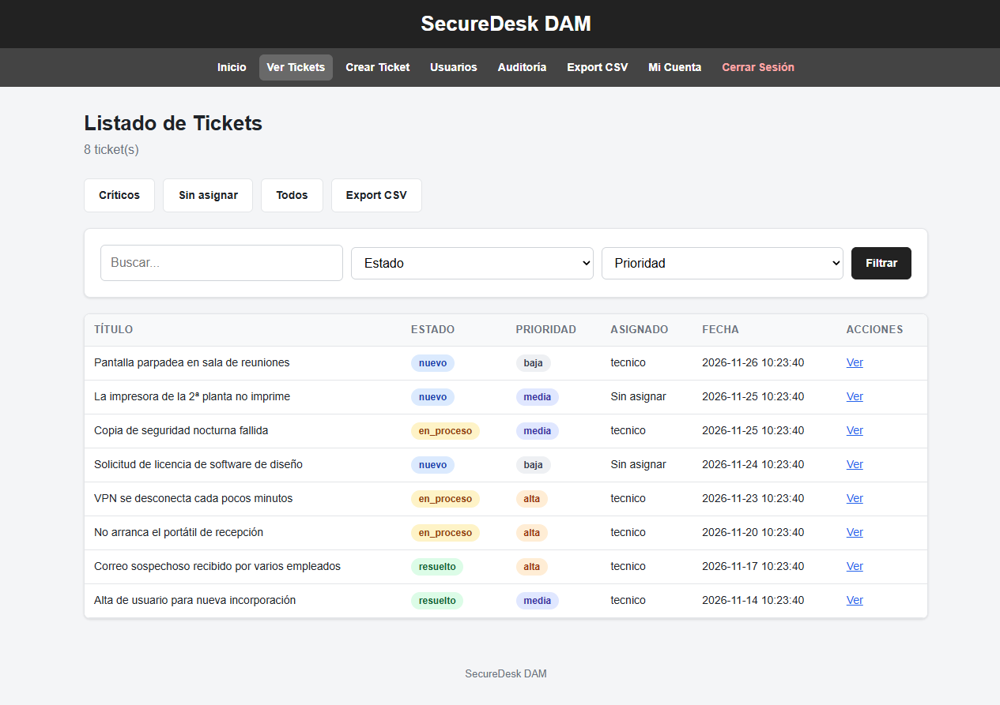
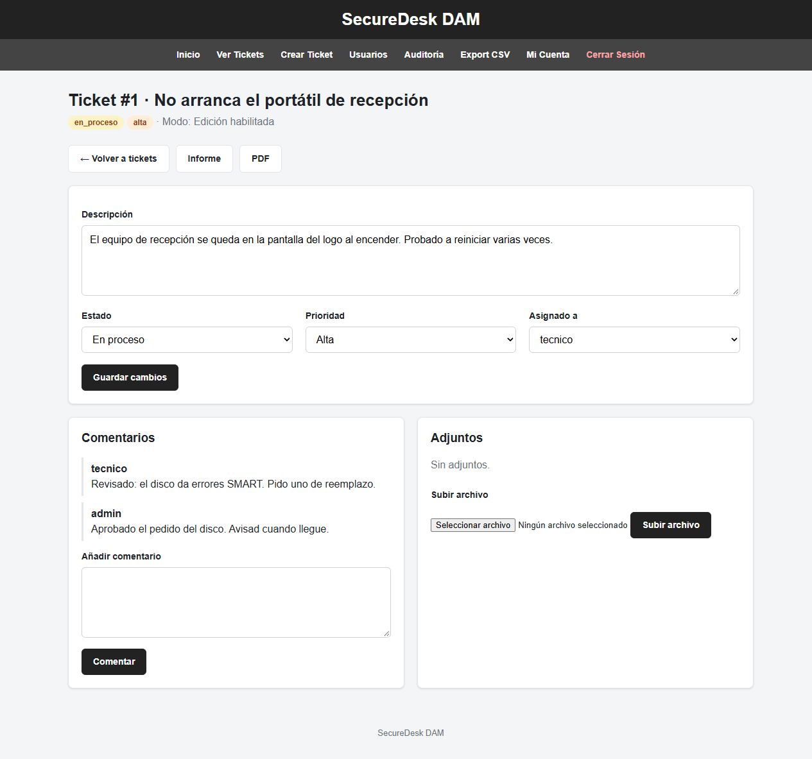
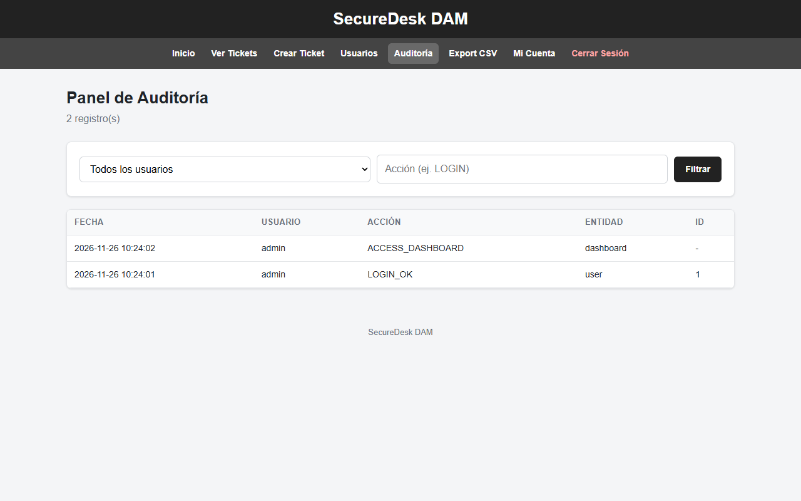
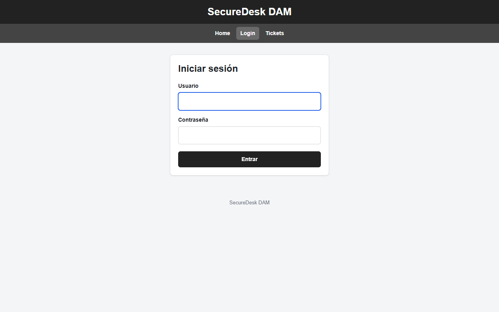

# SecureDesk DAM

Aplicación web de **gestión de incidencias (helpdesk)** con control de acceso por roles y registro de auditoría, desarrollada en **PHP 8 + SQLite** como proyecto del ciclo de Desarrollo de Aplicaciones Multiplataforma (DAM).

Permite a un equipo de soporte crear tickets, asignarlos a técnicos, seguir su estado, comentar, adjuntar archivos y exportar informes, dejando constancia de cada acción relevante.



## Funcionalidades

- **Tickets**: crear, editar, filtrar (estado, prioridad, texto), asignar a técnicos, comentarios, adjuntos descargables e historial de cambios.
- **Panel** con métricas por estado, prioridad y categoría, y accesos rápidos (críticos, sin asignar).
- **Roles** con permisos distintos:

  | Rol | Puede |
  |---|---|
  | `admin` | Todo: tickets, auditoría y exportaciones |
  | `tecnico` | Crear y editar tickets, comentar, subir adjuntos, exportar |
  | `lector` | Solo consultar tickets |

- **Auditoría**: registro de inicios de sesión (correctos y fallidos), accesos, búsquedas, ediciones y exportaciones, con filtro por usuario y acción.
- **Exportación** a CSV y a PDF (informe por ticket con Dompdf).

## Seguridad aplicada

- Contraseñas con `password_hash()` / `password_verify()`.
- Consultas preparadas con **PDO** en los accesos a base de datos (prevención de inyección SQL).
- **Token CSRF** en los formularios.
- Escapado de salida con `htmlspecialchars()` (prevención de XSS).
- Control de acceso por rol en servidor (`requireLogin()` / `requireRole()`).
- **Bloqueo tras 5 intentos fallidos** de inicio de sesión durante 15 minutos (también para usuarios inexistentes, para no revelar cuáles existen).
- Regeneración del identificador de sesión al iniciar sesión (prevención de fijación de sesión).
- Cierre de sesión automático tras 15 minutos de inactividad, aplicado en todas las páginas protegidas.
- Al cerrar sesión se destruye la sesión en el servidor, no solo la cookie.
- Subida de archivos validada por **tamaño, extensión y tipo MIME real**, con nombres aleatorios y descarga a través de PHP.
- Carpetas internas (`db/`, `app/`, `includes/`, `views/`, `uploads/`, `vendor/`) bloqueadas al acceso web con `.htaccess`; solo `public/` es accesible.
- Páginas de error propias (403, 404, 500) sin exponer detalles internos.

## Capturas

| Listado de tickets | Detalle de ticket |
|---|---|
|  |  |

| Auditoría | Login |
|---|---|
|  |  |

## Cómo ejecutarlo

Requisitos: [XAMPP](https://www.apachefriends.org/) (Apache + PHP 8.x con la extensión `pdo_sqlite`, activada por defecto).

1. Descarga el proyecto en la carpeta `htdocs` de XAMPP:
   ```bash
   cd C:\xampp\htdocs
   git clone https://github.com/Piza2026/securedesk-dam.git
   ```
2. Abre el **XAMPP Control Panel** e inicia **Apache**.
3. Entra en **http://localhost/securedesk-dam/**

No hace falta instalar nada más: la base de datos SQLite con datos de ejemplo y las dependencias (`vendor/`) están incluidas.

### Sin XAMPP

Con PHP 8 instalado, desde la carpeta del proyecto:

```bash
php -S localhost:8000 -t public
```

Y abre **http://localhost:8000**.

### Usuarios de prueba

| Usuario | Contraseña | Rol |
|---|---|---|
| `admin` | `1234` | Administrador |
| `tecnico` | `1234` | Técnico |
| `lector` | `1234` | Solo lectura |

Para restaurar los datos de demostración en cualquier momento:

```bash
php db/seed_demo.php
```

## Estructura

```
securedesk-dam/
├── public/      Páginas accesibles desde el navegador (punto de entrada)
│   └── assets/  Hoja de estilos
├── app/         Autenticación, roles, CSRF y auditoría
├── includes/    Gestión de errores
├── views/       Plantilla común (cabecera, menú) y vistas
├── db/          Conexión, esquema, base de datos SQLite y scripts de datos
├── uploads/     Adjuntos subidos por los usuarios (no se versionan)
└── vendor/      Dependencias de Composer (Dompdf)
```

## Tecnologías

PHP 8 · SQLite · PDO · HTML5 / CSS3 · Dompdf · Apache (XAMPP)
